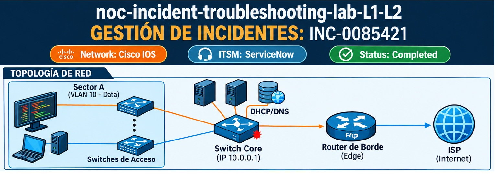
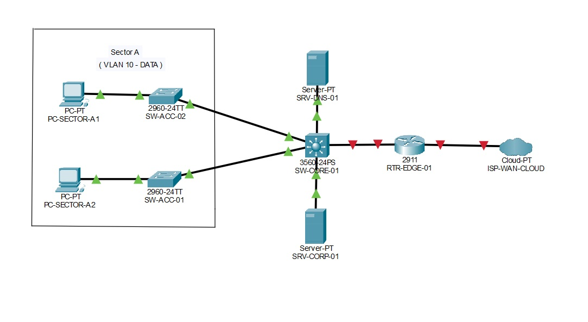
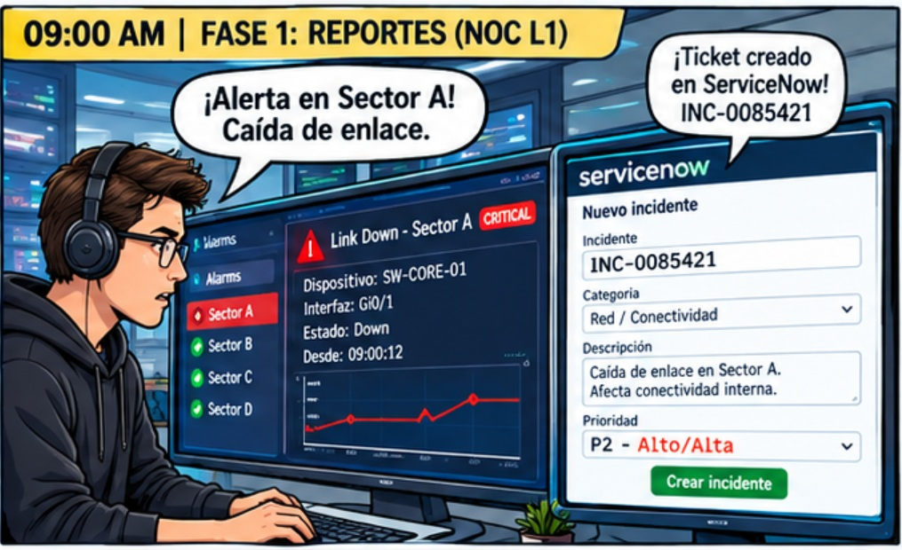
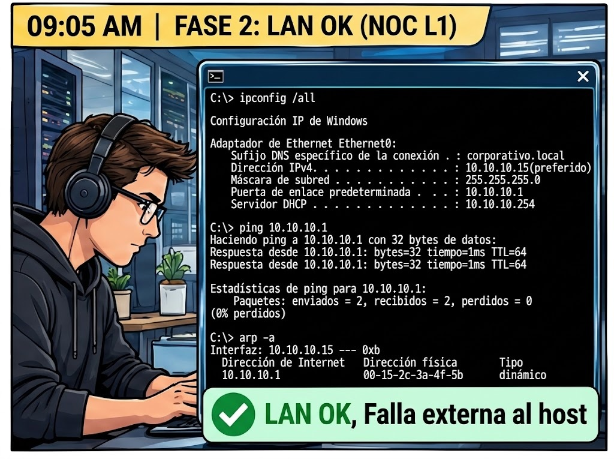
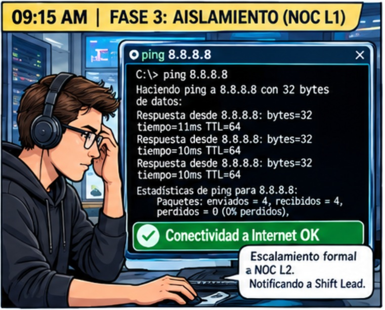
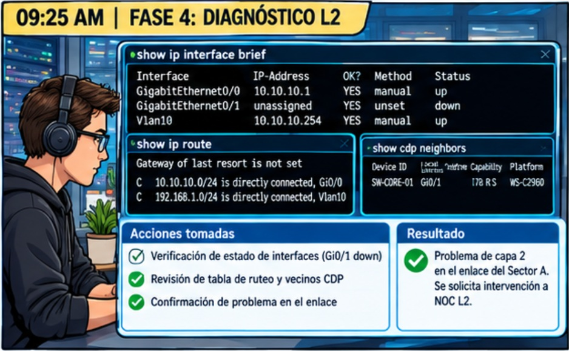
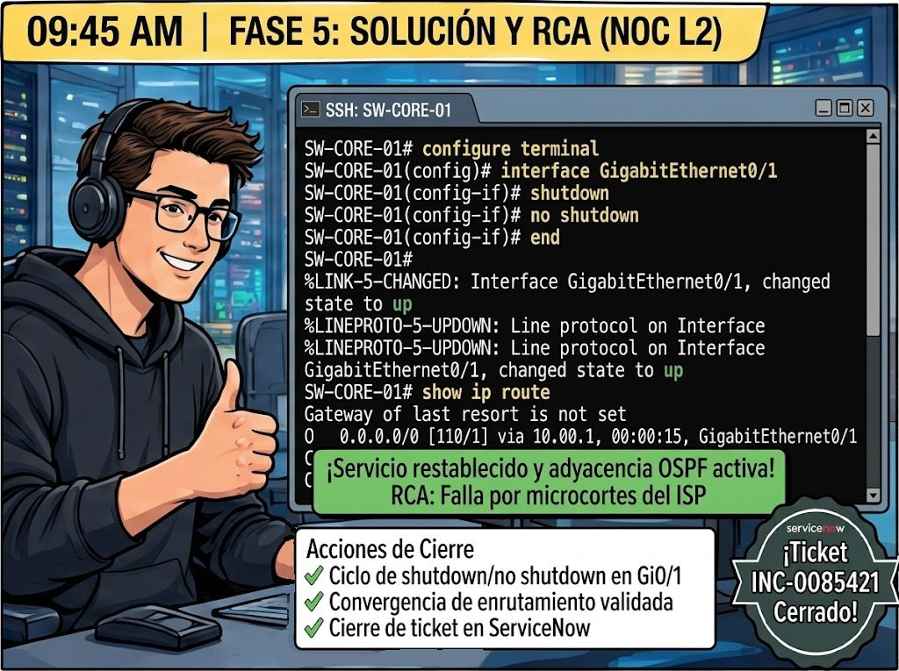

# 🛠️ NOC Operations & Troubleshooting Lab: Enterprise Incident Management (L1/L2)

[](https://www.cisco.com)
[](https://www.servicenow.com)
[]()

---




## 📄1. Descripción General del Proyecto

Este repositorio documenta un **Procedimiento Operativo Estándar (SOP)** y la resolución técnica simulada de un incidente crítico de red (pérdida total de conectividad en una sucursal corporativa). El ejercicio simula con rigor el flujo operativo diario en un centro de operaciones de redes (**NOC - Network Operations Center**), integrando la gestión de servicios de TI bajo marcos **ITIL**, el diagnóstico escalonado de infraestructura (L1 a L2) y la ejecución de comandos de diagnóstico avanzado en equipos Cisco.

---

## 🏗️2. Topología y Componentes de Red


## El laboratorio simula una red corporativa segmentada estructurada de la siguiente manera:

* **Capa de Acceso:** Switches Cisco Catalyst (ej. SW-ACC-01) conectados a los puestos de trabajo del Sector A (VLAN 10 - Data).
* **Capa de Distribución / Core:** Switch Cisco Core (SW-CORE-01) encargado del enrutamiento inter-VLAN y la puerta de enlace predeterminada.
* **Capa de Borde (Edge):** Router de salida (RTR-ISP-01) conectado al proveedor de servicios de internet (ISP) mediante enlaces dedicados con encapsulamiento estático/dinámico.
* **Servicios de Red:** Servidor DHCP corporativo y servidores DNS redundantes.

---

## 📋3. Gestión ITSM y Modelo de Ticketing (ServiceNow)

Todo el ciclo de vida del evento se administra bajo estrictos estándares de la plataforma **ServiceNow (SNOW)**:

* **Canal de Entrada:** Alerta automática de monitoreo (SolarWinds/Zabbix) combinada con reporte telefónico de usuario.
* **Priorización de Incidente:** 
  * **Impacto:** Alto (Afectación a un sector completo de usuarios).
  * **Urgencia:** Alta.
  * **Prioridad Resultante:** P2 (SLA de atención inicial: 15 minutos | SLA de resolución: 4 horas).
* **Matriz de Escalamiento Operativo:** 
  * **NOC L1:** Triage, verificación física y comandos básicos de host.
  * **NOC L2:** Diagnóstico de equipos activos, análisis de CLI y mitigación.
  * **NOC L3 / Vendor:** Soporte avanzado, hardware RMA o ingeniería de diseño.

---

## 🚨4. Bitácora de Resolución de Incidente: INC-0085421

### ⏱️ 09:00 AM | Fase 1: Recepción, Triage y Capa 1 (Rol: NOC L1)


El sistema de monitoreo dispara una alarma de caída de enlace en el Sector A. Varios usuarios reportan imposibilidad de trabajar.

* **Acción ITSM:** El Operador L1 abre el ticket `INC-0085421`, asigna la categoría `Network / LAN-WAN` y activa el cronómetro de SLA.
* **Verificación Física (Capa 1):** Se descartan cortes físicos masivos. Las interfaces de acceso se encuentran arriba (Link UP).
* **Work note en ServiceNow:** "09:02 AM - [NOC L1] Apertura de INC-0085421 por pérdida de conectividad en Sector A. Enlaces físicos validados. Iniciando validación de parámetros IP en terminales."

### ⏱️ 09:05 AM | Fase 2: Diagnóstico de Red Local - Capas 2 y 3 (Rol: NOC L1)


Se selecciona un equipo testigo para verificar la correcta integración con la LAN.

* **Comandos Ejecutados en Terminal:**

```cmd
ipconfig /all
ping 10.10.10.1
arp -a
```

* **Análisis de Resultados:** El host obtiene una dirección IP válida por DHCP corporativo. El ping al Default Gateway (10.10.10.1) responde con un tiempo óptimo de 1ms y la tabla ARP resuelve correctamente la dirección MAC del router/switch core. La capa física y de enlace local operan sin anomalías.
* **Work note en ServiceNow:** "09:10 AM - [NOC L1] Parámetros IP correctos obtenidos vía DHCP. Comunicación con Gateway local exitosa (Latency: 1ms). Se descarta problema de tarjeta de red o cableado del usuario. La falla es externa al segmento local."

### ⏱️ 09:15 AM | Fase 3: Aislamiento del Dominio de Falla y Escalamiento (Rol: NOC L1 ➡️ L2)

Para determinar el alcance de la interrupción, se ejecutan pruebas hacia la red WAN e Internet.

* **Comandos Ejecutados:**

```cmd
ping 8.8.8.8
nslookup corporativo.local
tracert 8.8.8.8
```

* **Análisis de Resultados:** El comando `nslookup` falla por tiempo de espera agotado. El `tracert` muestra que los paquetes llegan al primer salto (Gateway 10.10.10.1), pero mueren en el segundo salto correspondiente al enlace troncal hacia el Switch Core (`10.0.0.1`).
* **Procedimiento de Escalamiento:** Al superar el alcance operativo del L1, se reasigna formalmente el ticket al grupo resolutor `NOC_Routing_Switching_L2` y se notifica al Shift Lead vía canal de guardia por impacto en SLA.
* **Work note en ServiceNow:** "09:20 AM - [NOC L1] Tráfico bloqueado en el salto 10.0.0.1 (SW-CORE). Se adjuntan trazas de diagnóstico. Escalamiento formal ejecutado hacia NOC L2. Shift Lead alertado."

### ⏱️ 09:25 AM | Fase 4: Diagnóstico de Infraestructura Activa (Rol: NOC L2)


El ingeniero L2 toma posesión del incidente y accede mediante acceso seguro (SSH) al nodo central de conmutación.

* **Comandos CLI Ejecutados (Cisco IOS):**

```cisco
show ip interface brief
show ip route
show logging | include LINK
```

* **Análisis de CLI y Logs:** El comando `show ip interface brief` revela que la interfaz troncal `GigabitEthernet0/1` (hacia el enrutador de borde del ISP) se encuentra en estado `administratively down` / `err-disable`. El archivo de registro (`show logging`) evidencia un evento de ráfaga de errores de CRC y microcortes a las 08:50 AM, lo que activó el mecanismo de seguridad de protección de puerto (err-disable).
* **Work note en ServiceNow:** "09:35 AM - [NOC L2] Acceso SSH al nodo SW-CORE-01 exitoso. Se identifica la interfaz Gi0/1 en estado err-disable por saturación de errores físicos en el enlace de subida del ISP."

### ⏱️ 09:45 AM | Fase 5: Mitigación, Resolución y RCA (Rol: NOC L2)


### Se procede con la recuperación del servicio aplicando el procedimiento de reactivación de interfaz y validación de protocolos de enrutamiento.

* **Acciones de Mitigación (CLI):**

```cisco
configure terminal
interface GigabitEthernet0/1
shutdown
no shutdown
end
```


* **Validación de Convergencia:** Se verifica que la adyacencia del protocolo de enrutamiento dinámico (OSPF) levante y que las rutas vuelvan a poblar la tabla con `show ip route`. Se comprueba la navegación de los usuarios de prueba.
* **Cierre del Ticket en ServiceNow:**
  * **Código de Cierre:** Resolved - Network Configuration / Port Reset
  * **Análisis de Causa Raíz (RCA):** "El puerto GigabitEthernet0/1 del Switch Core entró en estado err-disable debido a una alta tasa de errores de trama generados por fluctuaciones eléctricas temporales en el conversor de medios del proveedor de internet (ISP). La intervención manual de L2 mediante ciclo de apagado administrativo (shutdown/no shutdown) restableció la capa física y la convergencia OSPF."
  * **Acción Preventiva:** Se solicitó al área de operaciones de campo coordinar una revisión de parámetros físicos con el proveedor de enlace dedicado.
* **Work note final en ServiceNow:** "10:00 AM - [NOC L2] Servicio totalmente restablecido. Pruebas de conectividad punta a punta exitosas. Se notifica al usuario principal y se cierra el incidente dentro del SLA establecido."
* 

---

# 📊5. Métricas de Operación y KPIs del Incidente

* **MTTA (Mean Time to Acknowledge):** 3 minutos.
* **MTTT (Mean Time to Triage / Escalate):** 18 minutos.
* **MTTR (Mean Time to Repair):** 52 minutos (Dentro del SLA de 4 horas para incidentes P2).


---

# 📂 Estructura del Laboratorio de Redes

* **[`topologia_noc_lab.pkt`](./topologia_noc_lab.pkt)** — Archivo principal de Cisco Packet Tracer que contiene la topología corporativa completa del **Sector A (VLAN 10 - Data)**, switches de acceso (`SW-ACC-01`, `SW-ACC-02`), switch multicapa (`SW-CORE-01`), servidores de infraestructura (`SRV-CORP-01` DHCP y `SRV-DNS-01`) y el enrutador de borde (`RTR-EDGE-01`). Cualquier usuario puede hacer clic en el enlace para descargar el archivo y probarlo directamente.

# 📋 Detalles Técnicos y Validación del Incidente (`INC-0085421`)
* **Capa 2 y VLANs:** Configuración de puertos de acceso y enlaces troncales 802.1q (`dot1q`) optimizados para evitar bloqueos de Spanning Tree y discrepancias de VLAN nativa.
* **Capa 3 y Servicios:** Servidor DHCP corporativo configurado en el pool `10.10.10.x` validado con asignación estática de puerta de enlace y DNS.
* **Estado del Escenario:** El escenario se encuentra en su estado simulado de incidente (enlace de borde en `shutdown` en el puerto `Gi0/1` del Core) para su posterior análisis, diagnóstico y resolución técnica en nivel NOC L1/L2.

# 🌐 Laboratorio Práctico NOC L1 / L2: Diagnóstico y Solución de Red

## 🎯 ¿De qué trata este proyecto?
Este escenario simula una **red corporativa real** para practicar y demostrar cómo trabaja un analista de un **Centro de Operaciones de Red (NOC)** cuando se enfrenta a problemas cotidianos de conectividad en las **Capas 1 y 2**.

---

## 🔍 ¿Cómo está armado? (La Topología)
El laboratorio en **[`topologia_noc_lab.pkt`](./topologia_noc_lab.pkt)** cuenta con:
* **Sector A (Usuarios):** Dos PCs de usuarios conectadas a switches de acceso (`SW-ACC-01` y `SW-ACC-02`).
* **Core (Corazón de la red):** Un switch central multicapa (`SW-CORE-01`) que administra las VLANs y el tráfico.
* **Servidores:** Un servidor encargado de entregar las direcciones IP automáticamente (**DHCP**) y otro de nombres (**DNS**).
* **Borde:** Un router de salida (`RTR-EDGE-01`) conectado a la nube del proveedor de internet.

---

## 🛠️ ¿Qué problemas resolvimos (Nivel L1 y L2)?
1. **Problema de Capa 1 y Enlaces (L1):** Corregimos las conexiones físicas y los estados de los puertos para que dejen de estar caídos o bloqueados.
2. **Problema de Capa 2 (L2):** 
   * Configuramos correctamente los **puertos troncales (`Trunk`)** entre los switches para que las VLANs fluyan sin errores de Spanning Tree.
   * Configuramos los **puertos de acceso** en la **VLAN 10** para los equipos del Sector A.
3. **Servicios de Red (DHCP):** Logramos que las computadoras dejen de usar direcciones automáticas de error (APIPA / `169.254.x.x`) y reciban con éxito su IP corporativa (`10.10.10.x`) desde el servidor.

---

## 🛑 Estado Actual del Escenario
Para que cualquiera pueda probarlo y auditarlo, el laboratorio se entrega con una **falla controlada**: el puerto de salida hacia el router de borde está apagado (`shutdown`). 
* *Ideal para abrirlo en Packet Tracer, levantar el puerto y verificar cómo opera todo el flujo de red.*

---

## 👤 Autor

<p align="center">
  
</p>
🤝 Conclusión y Contacto 🤝


[](https://github.com/MarceloNH-IT)

* **💼 LinkedIn**: [Horacio Marcelo Nuñez](https://linkedin.com) 
* **📬 Correo Electrónico**: [marcelonh86@gmail.com](marcelonh86@gmail.com)
* **🚀 GitHub**: [@MarceloNunez-NOC](https://github.com/MarceloNunez-NOC)

---

## 🎯 Conclusión y Proyección Profesional

Agradezco el tiempo de quienes visitan este repositorio. Este proyecto forma parte de mi camino de formación continua en **Python, redes y administración de sistemas**, diseñado para demostrar que puedo estructurar código limpio, documentar procesos y resolver problemas lógicos con un enfoque metódico.

Mi objetivo como profesional de IT es aportar valor mediante el diagnóstico preciso, la automatización de tareas y la documentación clara de incidentes. Los scripts que comparto reflejan mi capacidad de evolucionar desde la lógica básica hacia la resolución de escenarios complejos.

Invito a reclutadores, colegas y referentes del sector a explorar mis repositorios, donde continuo integrando herramientas de redes, infraestructura y programación. Estoy abierto a colaborar y aportar mi experiencia en entornos tecnológicos que valoren la constancia, el orden y la resolución analítica de problemas.


